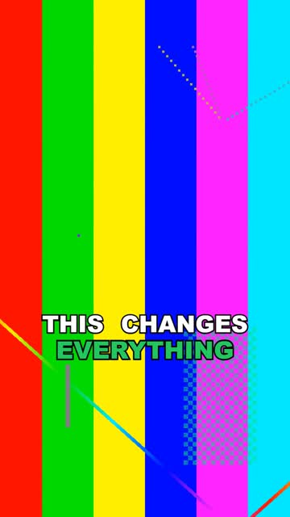

# vertical-ad-composer

A [Remotion](https://www.remotion.dev) template for **9:16 short-form video ads** (TikTok, Reels, Shorts). Describe a piece as a small JSON *plan* and get a finished MP4 with animated captions, highlighted keywords, b-roll cuts, an app pop-in with sound effect, and an optional call-to-action. Render one piece or a whole batch from a single command.



## Features

- **Animated captions** from a word-level transcript: short phrases, the active word grows, keywords use an accent color.
- **B-roll cuts** with a slow zoom so shots never feel static.
- **App pop-in**: a screen recording or screenshot springs up with a shadow, with a sfx on the first frame.
- **CTA box** with a bouncing arrow.
- **Voice, music and sfx** tracks with per-item volume.
- **Batch rendering**: one bundle, N plans, files referenced by any path (they are staged automatically).
- **Captions-only mode** to put the same captions over an already-edited video.

## Quick start

Requirements: Node 18+, and `ffmpeg` on your PATH (only needed to generate the demo clips).

```bash
npm install
npm run demo-assets   # creates two tiny placeholder clips in public/demo/
npm run render        # renders batches/demo.json -> renders/demo-01.mp4
npm run studio        # optional: live preview in Remotion Studio
```

## The plan format

All times are in **seconds**.

```jsonc
{
  "id": "my-piece", "fps": 30, "duration": 12,
  "voice": "voice.wav",                         // optional voice-over
  "music": { "src": "music.mp3", "volume": 0.12 },
  "avatar": [{ "src": "host.mp4", "from": 0, "to": 3 }],        // talking-head segments
  "cuts":   [{ "src": "broll1.mp4", "from": 3, "to": 4.5, "start": 2, "x": 0.4 }],
  "app":    [{ "src": "screen.mp4", "from": 6, "to": 9, "sfx": "pop.wav" }],
  "cta":    [{ "from": 10, "to": 12, "text": "Tap here" }],
  "words":  [{ "t0": 0.1, "t1": 0.5, "w": "This" }],             // word-level transcript
  "highlight": ["free", "app"],                  // keywords in the accent color
  "style": { "color": "#22C55E", "posY": 0.6, "size": 86, "maxWords": 3 },
  "sfx": [{ "src": "whoosh.wav", "t": 3, "volume": 0.8 }]
}
```

| Field | Meaning |
|---|---|
| `from` / `to` | When the item is on screen (seconds on the timeline). |
| `start` | Where to start inside the source clip. |
| `x` | Horizontal crop focus for the 9:16 cover (0 = left, 1 = right). |
| `words` | `{t0, t1, w}` per word. Any word-level transcriber works (for example faster-whisper). |
| `style.posY` | Vertical caption position as a fraction of the height. |

### Batches

```json
{ "output": "../renders", "plans": [ { "id": "a", "...": "..." }, "plans/b.json" ] }
```

```bash
node render-batch.mjs batches/my-batch.json --concurrency 4 --only a
```

File paths inside plans may be absolute or relative to the batch file. They are copied to `public/_batch/` and rewritten for you.

## Project layout

```
src/Montage.jsx     the composition (cuts, app pop-in, captions, CTA, audio)
src/Root.jsx        registers Montage and CaptionsOnly; duration comes from the plan
render-batch.mjs    batch renderer
batches/demo.json   example batch
```

## Validation and tests

`render-batch.mjs` validates every plan before rendering and reports clear errors (missing `src`, `to` before `from`, items running past `duration`, malformed words). The validator lives in `validate-plan.mjs` and has unit tests:

```bash
npm test
```

CI runs the tests on Node 18, 20 and 22. Contributions are welcome: see the open issues labelled `good first issue`.

## Tips

- Keep b-roll cuts around 1.5 s or shorter; keep talking-head segments short too.
- Show the app only when the script names it, and let the sfx land on its first frame.
- Normalize your voice track before rendering (for example to -14 LUFS).

## License

MIT. Remotion itself has its own [license](https://github.com/remotion-dev/remotion/blob/main/LICENSE.md); check that it fits your use, especially for companies.
